# Lab 03 – REST API, Query Parameters, Validation and Debugging

## 1. Student Details

- **Name:** JANUMURI YESWANTH
- **Registration Number:** 252U1R9046
- **Section:** CSE GEN-AI, 304
- **Subject:** Backend Development Fundamentals
- **Academic Year/Term:** Year II, Term II
- **University:** Aurora Deemed to be University
- **Faculty:** Mr. Joel Prashanth D.

---

## 2. Introduction

In this lab, I developed a REST API using Node.js, Express.js and SQLite. The main purpose of this lab was to understand how REST API endpoints work and how to perform different operations on book records.

I implemented searching, filtering, sorting, pagination and CRUD operations. I also practised input validation and error handling using HTTP status codes.

## 3. Objectives

1. To understand REST API principles.
2. To create API endpoints using Express.js.
3. To implement searching and filtering using query parameters.
4. To implement sorting and pagination.
5. To perform Create, Read, Update and Delete operations.
6. To validate user input.
7. To handle errors using appropriate HTTP status codes.
8. To understand basic debugging techniques.

## 4. Technologies Used

- **Node.js:** JavaScript runtime environment.
- **Express.js:** Framework used to create REST API endpoints.
- **SQLite:** Database used to store book information.
- **JavaScript:** Programming language used for backend development.
- **Visual Studio Code:** Code editor.
- **PowerShell:** Used to execute and test API requests.

## 5. Project Structure

```text
lab-03/
│
├── app.js
├── books.db
├── package.json
├── package-lock.json
├── node_modules/
│
├── screenshots/
│   ├── get-all-books.png
│   ├── search-books.png
│   ├── min-price-filter.png
│   ├── max-price-filter.png
│   ├── sort-title.png
│   ├── sort-descending.png
│   ├── pagination-first-page.png
│   ├── pagination-second-page.png
│   ├── validation-error.png
│   ├── invalid-price-range.png
│   ├── post-create-book.png
│   ├── verify-created-book.png
│   ├── put-update-book.png
│   ├── verify-updated-book.png
│   ├── delete-book.png
│   ├── verify-deleted-book.png
│   ├── delete-404-error.png
│   ├── post-missing-title.png
│   ├── post-invalid-price.png
│   └── put-404-error.png
│
└── README.md
```

*Note: The screenshots listed above are examples of filenames. Keep only the files that actually exist in your screenshots folder. Do not submit node_modules or books.db if your instructor does not require the database file.*

## 6. Installation and Setup

### Step 1: Install Node.js

Node.js was installed to execute JavaScript code on the computer.

### Step 2: Initialize the Project

```bash
npm init -y
```

### Step 3: Install Dependencies

```bash
npm install express sqlite3
```

Install Nodemon for development:

```bash
npm install --save-dev nodemon
```

### Step 4: Start the Application

```bash
npm run dev
```

The server runs at:

```text
http://localhost:3000
```

## 7. Database Description

The project uses an SQLite database named `books.db`.

The books table contains the following columns:

| Column | Description |
|---|---|
| id | Unique book ID |
| title | Name of the book |
| author | Name of the author |
| price | Price of the book |
| pages | Number of pages |

Sample records:

| ID | Title | Author | Price | Pages |
|---|---|---|---:|---:|
| 1 | Wings of Fire | A.P.J. Abdul Kalam | 250 | 180 |
| 2 | The Alchemist | Paulo Coelho | 300 | 208 |
| 3 | Atomic Habits | James Clear | 450 | 320 |

## 8. REST API Endpoints

| HTTP Method | Endpoint | Description |
|---|---|---|
| GET | `/books` | Retrieve all books |
| POST | `/books` | Create a new book |
| PUT | `/books/:bookId` | Update an existing book |
| DELETE | `/books/:bookId` | Delete a book |

### GET – Retrieve Books

The GET endpoint retrieves all available books from the database.

Example:

```text
http://localhost:3000/books
```

### POST – Create a Book

The POST endpoint inserts a new book into the database.

Example request body:

```json
{
  "title": "Clean Code",
  "author": "Robert C. Martin",
  "price": 550,
  "pages": 464
}
```

Expected response:

```json
{
  "message": "Book created successfully",
  "bookId": 4
}
```

### PUT – Update a Book

The PUT endpoint updates an existing book using its ID.

Example:

```text
PUT /books/4
```

Example request body:

```json
{
  "title": "Clean Code Updated",
  "author": "Robert C. Martin",
  "price": 600,
  "pages": 464
}
```

Expected response:

```json
{
  "message": "Book updated successfully"
}
```

### DELETE – Delete a Book

The DELETE endpoint removes a book using its ID.

Example:

```text
DELETE /books/4
```

Expected response:

```json
{
  "message": "Book deleted successfully"
}
```

## 9. Query Parameters

Query parameters help retrieve specific records from the database.

| Parameter | Description |
|---|---|
| search | Searches books by title or author |
| minPrice | Filters books using minimum price |
| maxPrice | Filters books using maximum price |
| sortBy | Selects the field used for sorting |
| order | Specifies ascending or descending order |
| limit | Specifies the maximum number of records |
| offset | Specifies the number of records to skip |

### 9.1 Searching Books

Example:

```text
http://localhost:3000/books?search=Atomic
```

This searches for books containing the word Atomic in the title or author.

### 9.2 Minimum Price Filter

Example:

```text
http://localhost:3000/books?minPrice=300
```

This displays books with a price greater than or equal to 300.

### 9.3 Maximum Price Filter

Example:

```text
http://localhost:3000/books?maxPrice=300
```

This displays books with a price less than or equal to 300.

### 9.4 Sorting Books

Example:

```text
http://localhost:3000/books?sortBy=price&order=desc
```

This displays books in descending order of price.

### 9.5 Pagination

First page:

```text
http://localhost:3000/books?limit=2&offset=0
```

Second page:

```text
http://localhost:3000/books?limit=2&offset=2
```

Pagination displays a limited number of records on each page.

## 10. Input Validation

Input validation ensures that the API receives correct information.

The following validations were implemented:

1. Title, author and price are required when creating a book.
2. Price must be a valid non-negative number.
3. Pages must be a positive integer.
4. Minimum price cannot be greater than maximum price.
5. Invalid book IDs return a not-found response.

### Example: Missing Title

If the title is missing, the API returns:

```json
{
  "message": "Title, author and price are required"
}
```

### Example: Invalid Price

If the price is entered as a string such as `abc`, the API returns a validation error.

## 11. HTTP Status Codes

| Status Code | Meaning |
|---|---|
| 200 | Request completed successfully |
| 201 | New book created successfully |
| 400 | Invalid request or input |
| 404 | Book not found |
| 500 | Internal server error |

## 12. API Testing

The API was tested using browser requests and PowerShell commands.

| Test Case | Expected Result |
|---|---|
| Retrieve all books | 200 OK |
| Search for a book | Matching records |
| Filter by minimum price | Matching records |
| Filter by maximum price | Matching records |
| Sort by price | Sorted records |
| Pagination | Limited records |
| Create a book | 201 Created |
| Update a book | 200 OK |
| Delete a book | 200 OK |
| Invalid price | 400 Bad Request |
| Missing title | 400 Bad Request |
| Delete missing book | 404 Not Found |
| Update missing book | 404 Not Found |

*Note: The assignment asks for a Postman test list. These test cases should also be executed and documented in Postman if required by the instructor. Browser and PowerShell testing alone should not be described as Postman testing.*

## 13. Debugging

During development, I learned about common backend errors and how to identify them.

- **EADDRINUSE:** Occurs when the selected port is already being used by another process.
- **Wrong import path:** Happens when a required module or file path is incorrect.
- **Table name typo:** Occurs when the SQL query uses an incorrect database table name.
- **Missing await:** Can cause problems when asynchronous operations are not handled correctly.

Debugging helped me understand how to identify errors and correct them during backend development.

## 14. Screenshots

The screenshots captured during execution are stored in the `screenshots` folder.

They demonstrate:

- Server execution.
- Retrieving all books.
- Searching and filtering.
- Sorting and pagination.
- Validation errors.
- Creating a book.
- Updating a book.
- Deleting a book.
- Handling missing book IDs.

Add the actual screenshots below using Markdown image links. Example:
### 1. Search Books
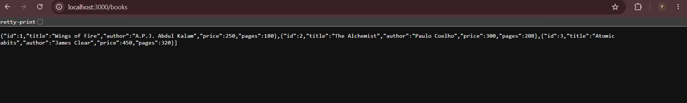

### 2. Search With No Results
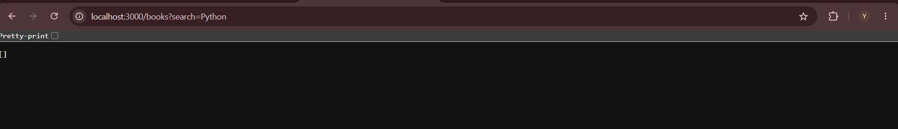

### 3. Filter Books
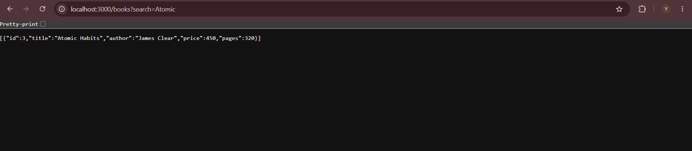

### 4. Maximum Price Filter
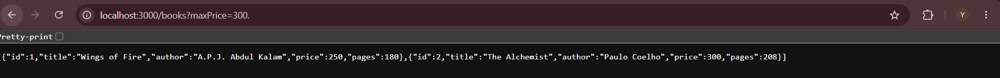

### 5. Sort by Title
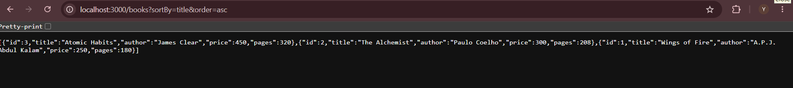

### 6. Sort by Descending Price
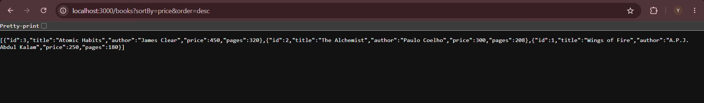

### 7. Sort by Ascending Price
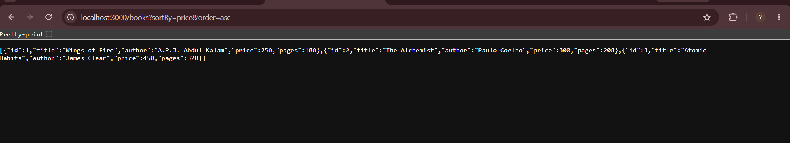

### 8. Pagination – First Page
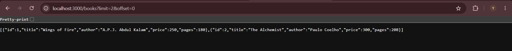

### 9. Pagination – Second Page
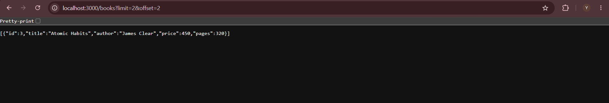

### 10. Update Book
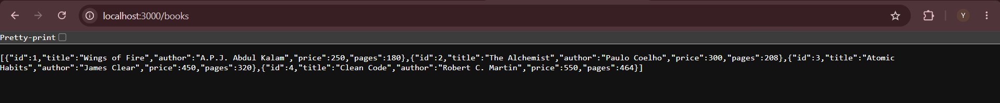

### 11. Delete Book
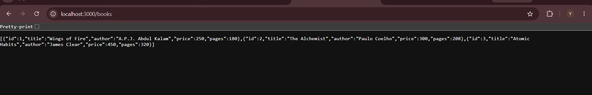

### 12. PUT 404 Error
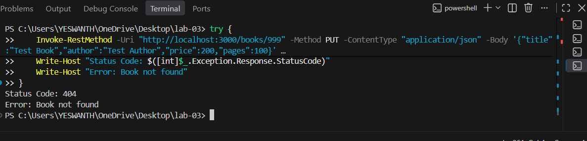

```markdown


```

## 15. Conclusion

Through this lab, I learned how to develop REST APIs using Node.js and Express.js with an SQLite database. I understood how different HTTP methods are used to perform CRUD operations.

I also practised searching, filtering, sorting and pagination using query parameters. Input validation and error handling helped me understand how to manage incorrect user requests and return appropriate HTTP status codes.

Overall, this lab improved my understanding of backend development and gave me practical experience in creating and testing REST APIs.

## 16. GitHub Repository

**GitHub Repository:** [Paste your friend's public GitHub repository URL here]

**Live Deployment URL:** [Add the deployed API URL if available]

If the application has not been deployed, mention:

`The application was executed and tested locally using http://localhost:3000. Live deployment was not completed.`
